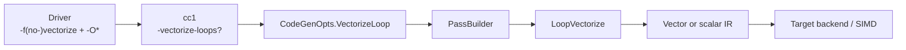

import Head from '@docusaurus/Head';
import FlagArticleShell from '@site/src/components/clang-flags/FlagArticleShell';
import AsmDiff from '@site/src/components/clang-flags/AsmDiff';
import Callout from '@site/src/components/clang-flags/Callout';
import SourceCode from '@site/src/components/clang-flags/SourceCode';
import KeyFacts from '@site/src/components/clang-flags/KeyFacts';
import Tabs from '@theme/Tabs';
import TabItem from '@theme/TabItem';

<Head>
  <title>-fno-vectorize | Clang Flags Explorer</title>
  <meta name="description" content="Disable Clang loop vectorization (-vectorize-loops / LoopVectorize). Defaults by -O level, driver vs cc1, IR/asm evidence, and adjacent SLP controls." />
  <meta name="keywords" content="-fno-vectorize,-fvectorize,-fno-tree-vectorize,-Qvec-,LoopVectorize,-vectorize-loops,clang,llvm,auto-vectorization,-fno-slp-vectorize" />
  <meta property="og:title" content="-fno-vectorize — Clang flag reference" />
  <meta property="og:description" content="Request that Clang omit LoopVectorize for this TU. Verified O-level defaults, driver→cc1→PassBuilder pipeline, and saxpy before/after asm." />
  <meta property="og:type" content="article" />
  <meta name="twitter:title" content="-fno-vectorize — Clang flag reference" />
  <meta name="twitter:description" content="Disable Clang loop vectorization with verified -O defaults, pipeline stages, and assembly evidence." />
</Head>

{/* HAND_AUTHORED */}
<FlagArticleShell flagPath="-fno-vectorize" summary="Request that Clang omit the loop vectorization passes where the driver would otherwise pass -vectorize-loops; defaults and profitability are optimization-level and target dependent. Does not control SLP vectorization.">

<div className="text--center margin-bottom--md"><a className="button button--primary button--lg" href="https://docs.google.com/forms/d/e/1FAIpQLSebP1JfLFDp0ckTxOhODKPNVeI1e21rUqMJ0fbBwJoaa-i4Yw/viewform" target="_blank" rel="noopener noreferrer" aria-label="Subscribe to CompilerSutra Weekly Compiler Notes">✉ Subscribe to Weekly Compiler Notes</a><p className="margin-top--sm">Practical LLVM, Clang, and compiler-engineering notes delivered weekly.</p></div>

## At a glance

| Attribute | Details |
| :--- | :--- |
| **Architecture** | Target-independent IR policy — SIMD shape still depends on the target (SSE/AVX, NEON, …) |
| **Category** | Code Generation / mid-end loop vectorization — not a backend codegen ABI knob |
| **Pipeline** | Driver O-level default → cc1 `-vectorize-loops` → `CodeGenOpts.VectorizeLoop` → PassBuilder → LoopVectorize → backend |
| **Compiler** | Clang (C/C++); GCC-compatible aliases `-fno-tree-vectorize`; clang-cl `-Qvec-`; Flang visibility in Options.td |
| **Optimization Level** | Loop vectorize **on** by default at `-O2`/`-O3`/`-Os`/`-Ofast`; **off** at `-O0`/`-O1` and for loops at `-Oz` (verified Ubuntu clang 18.1.3) |
| **Risk Level** | Low correctness risk when used as a diagnostic kill-switch; performance impact can be large on vectorizable loops |

**In one sentence:** `-fno-vectorize` tells the Clang driver not to enable the LoopVectorize pass for this translation unit, so loops that would otherwise widen into vector IR stay scalar (SLP / hand-written SIMD are separate).

---

## What this flag actually does

On modern Clang (verified with Ubuntu clang 18.1.3, triple `x86_64-pc-linux-gnu`):

1. **Driver policy** — `-fvectorize` / `-fno-vectorize` are resolved with `ArgList::hasFlag`, combined with `shouldEnableVectorizerAtOLevel(..., /*isSlpVec=*/false)`. When enabled, the driver appends cc1 `-vectorize-loops`; when disabled, that cc1 flag is absent.
2. **CC1 / CodeGenOptions** — `-vectorize-loops` sets `CodeGenOptions::VectorizeLoop`. There is no separate “vectorize=none” enum on the driver flag itself — omission of `-vectorize-loops` is the off state.
3. **Pass pipeline** — BackendUtil / PassBuilder schedules LLVM’s **LoopVectorize** pass when `VectorizeLoop` is set. `-fno-vectorize` keeps that pass out; it does **not** remove the rest of `-O2`.
4. **Backend** — Any remaining vector IR (intrinsics, SLP output, target builtins) still lowers to SIMD. This flag only gates automatic **loop** vectorization.

:::caution
`-fno-vectorize` is not “no SIMD,” not “no `-O2`,” and not `-fno-slp-vectorize`. OpenMP/`#pragma omp simd`, target intrinsics, and SLPVectorizer are separate knobs.
:::

### Option map and precedence

| Flag | Role |
| :--- | :--- |
| `-fno-vectorize` | Prefer disabling LoopVectorize (suppress cc1 `-vectorize-loops`) |
| `-fvectorize` | Prefer enabling LoopVectorize (emit `-vectorize-loops`) |
| `-fno-tree-vectorize` | Alias of `-fno-vectorize` (GCC spelling) |
| `-ftree-vectorize` | Alias of `-fvectorize` |
| `-Qvec-` / `-Qvec` | clang-cl aliases of `-fno-vectorize` / `-fvectorize` |
| `-fno-slp-vectorize` | Disable **SLP** vectorization only (`-vectorize-slp`) — orthogonal |
| `-fslp-vectorize` | Enable SLP vectorization |

**Precedence (simplified):** among `-fvectorize` / `-fno-vectorize`, the last one on the command line wins (`hasFlag` last-arg semantics). An explicit `-fvectorize` after `-fno-vectorize` re-enables `-vectorize-loops` even when the O-level default would keep it on.

---

## Defaults by optimization level (which `-O` introduces loop vectorize)

Verified experimentally — Ubuntu clang 18.1.3, triple `x86_64-pc-linux-gnu`, via `clang -###` looking for cc1 `-vectorize-loops` / `-vectorize-slp`:

| Last `-O` | Default `-vectorize-loops` (LoopVectorize) | Default `-vectorize-slp` (SLP) |
| :--- | :--- | :--- |
| (none) / `-O0` | off | off |
| `-O1` | off | off |
| `-O2` | **on** | **on** |
| `-O3` | **on** | **on** |
| `-Os` | **on** | **on** |
| `-Oz` | **off** | **on** |
| `-Ofast` | **on** | **on** |

Source (`llvmorg-18.1.3`, `clang/lib/Driver/ToolChains/Clang.cpp`): `shouldEnableVectorizerAtOLevel` returns true for `-Ofast`/`-O4`, false for `-O0`, true for `-Os`, and for numeric levels returns `OptLevel > 1`. For `-Oz`, loops return false while SLP (`isSlpVec == true`) returns true.

:::important
This table is the **driver default** for enabling the passes — not a guarantee that every loop vectorizes. Legality, trip-count heuristics, and target vector width still apply. Always confirm with `clang -###` and `-S -emit-llvm` on your triple and version.
:::

**Which optimization introduces it?** On this verified host, **`-O2` is the first standard numeric level** that enables loop vectorization by default (`OptLevel > 1`). `-Os` and `-Ofast` also enable it; `-O1` does not; `-Oz` enables SLP but not LoopVectorize.

---

## Minimal realistic example

<SourceCode
  file="saxpy.c"
  flag="-fno-vectorize"
  language="c"
  code={`void saxpy(float *restrict y, const float *restrict x, float a, int n) {
  for (int i = 0; i < n; ++i)
    y[i] = a * x[i] + y[i];
}`}
  note="restrict helps prove non-aliasing so LoopVectorize is allowed to widen the loop at -O2. Compare -O2 vs -O2 -fno-vectorize."
/>

```bash
clang -O2 -S -emit-llvm saxpy.c -o vec.ll
clang -O2 -fno-vectorize -S -emit-llvm saxpy.c -o novec.ll
clang -O2 -S saxpy.c -o vec.s
clang -O2 -fno-vectorize -S saxpy.c -o novec.s
```

At `-O2` without the flag, IR typically shows `<4 x float>` loads/stores and `llvm.loop.isvectorized`. With `-fno-vectorize`, the loop stays scalar `float` ops (the mid-end may still unroll lightly).

---

## Before vs. after assembly

Verified: Ubuntu clang 18.1.3, `x86_64-pc-linux-gnu`, `-O2`, source above.

<Tabs>
  <TabItem value="asm" label="x86_64 assembly">
    <AsmDiff
      beforeTitle="-O2 (LoopVectorize on)"
      afterTitle="-O2 -fno-vectorize"
      before={`LBB0_4:
        movups  (%rsi,%r8), %xmm2
        movups  16(%rsi,%r8), %xmm3
        movups  (%rdi,%r8), %xmm4
        movups  16(%rdi,%r8), %xmm5
        mulps   %xmm1, %xmm2
        addps   %xmm4, %xmm2
        mulps   %xmm1, %xmm3
        addps   %xmm5, %xmm3
        movups  %xmm2, (%rdi,%r8)
        movups  %xmm3, 16(%rdi,%r8)
        addq    $32, %r8
        cmpq    %r8, %rdx
        jne     LBB0_4`}
      after={`LBB0_7:
        movss   (%rsi,%rcx,4), %xmm1
        mulss   %xmm0, %xmm1
        addss   (%rdi,%rcx,4), %xmm1
        movss   %xmm1, (%rdi,%rcx,4)
        movss   4(%rsi,%rcx,4), %xmm1
        mulss   %xmm0, %xmm1
        addss   4(%rdi,%rcx,4), %xmm1
        movss   %xmm1, 4(%rdi,%rcx,4)
        addq    $2, %rcx
        cmpq    %rcx, %rdx
        jne     LBB0_7`}
    />
  </TabItem>
  <TabItem value="driver" label="Driver (-###)">
    Without `-fno-vectorize` at `-O2`, cc1 receives both `-vectorize-loops` and `-vectorize-slp`. With `-O2 -fno-vectorize`, `-vectorize-loops` is absent and `-vectorize-slp` remains (unless you also pass `-fno-slp-vectorize`).
  </TabItem>
</Tabs>

Packed `mulps`/`addps` over 32-byte strides become scalar `mulss`/`addss` (here still unrolled by 2). That is the LoopVectorize kill-switch in machine code — not a change to the ABI or frame layout.

---

## Why use it / when not to use it

### When to use

- Bisect a miscompile or FP noise you suspect came from LoopVectorize without dropping to `-O0`.
- Produce scalar reference asm/IR next to a vectorized build for teaching or reviews.
- Workloads where auto-vectorization regresses (tiny trip counts, heavy looping side effects) and you want a **targeted** disable.

### When not to use

- As a blunt “make `-O2` slower/safer” stand-in — prefer fixing the loop, aliasing annotations, or using `-fno-slp-vectorize` when SLP is the real culprit.
- Expecting it to disable OpenMP SIMD, `#pragma clang loop vectorize`, or hand-written intrinsics.
- Shipping it globally without measuring — many hot loops lose significant throughput.

---

## Performance impact

Disabling loop vectorization can remove large SIMD speedups on dense numeric loops (saxpy-class kernels). The delta is workload-dependent; measure with [CompilerSutraPerf](/docs/project/compilersutra-perf/) ([PyPI](https://pypi.org/project/compilersutra-perf/)) on your binary rather than assuming a fixed percent.

No `PerfReport` numbers are published on this page yet — run `csperf` locally before claiming a win or regression.

---

## Compatibility

| Compiler / mode | Support |
| :--- | :--- |
| **Clang driver** | `-fno-vectorize` / `-fvectorize` |
| **GCC spelling** | `-fno-tree-vectorize` / `-ftree-vectorize` (aliases) |
| **clang-cl** | `-Qvec-` / `-Qvec` |
| **MSVC cl** | `/Qvec-` is a MSVC spelling; behavior is not identical to Clang’s LoopVectorize pipeline — verify on your toolchain |
| **Flang** | Options.td marks FlangOption visibility; treat Fortran defaults as separately verified |

---

## Usage example

```bash
# Kill loop vectorization at -O2 (SLP may remain)
clang++ -O2 -fno-vectorize -c kernel.cpp -o kernel.o

# Confirm driver forwarding
clang -### -O2 -fno-vectorize -c kernel.cpp 2>&1 | tr ' ' '\n' | grep vectorize

# Force loop vectorize even at -O1 (experimental)
clang -O1 -fvectorize -S -emit-llvm kernel.cpp -o - | grep -E 'vector|fmul'
```

---

## Adjacent options

- `-fvectorize` — re-enable / force LoopVectorize (`-vectorize-loops`).
- `-fno-slp-vectorize` / `-fslp-vectorize` — SLPVectorizer only; independent of this flag.
- `-fno-tree-vectorize` / `-Qvec-` — spellings that alias `-fno-vectorize`.
- `-O2` / `-O3` / `-Os` / `-Ofast` — levels that **introduce** default loop vectorization on verified Clang 18.1.3 (`OptLevel > 1` or special-cased `-Os`/`-Ofast`).

---

## How it works inside Clang



| Pipeline stage | Implementation detail |
| :--- | :--- |
| **Options.td** | [`def fvectorize` / `def fno_vectorize`](https://github.com/llvm/llvm-project/blob/llvmorg-18.1.3/clang/include/clang/Driver/Options.td#L3758) plus aliases (`ftree-vectorize`); cc1 [`vectorize_loops`](https://github.com/llvm/llvm-project/blob/llvmorg-18.1.3/clang/include/clang/Driver/Options.td#L6925) |
| **Driver defaults** | [`shouldEnableVectorizerAtOLevel`](https://github.com/llvm/llvm-project/blob/llvmorg-18.1.3/clang/lib/Driver/ToolChains/Clang.cpp#L520) (`OptLevel > 1`, `-Os`, `-Ofast`; `-Oz` loops off) |
| **Driver forwarding** | [`hasFlag(OPT_fvectorize, …)` → `-vectorize-loops`](https://github.com/llvm/llvm-project/blob/llvmorg-18.1.3/clang/lib/Driver/ToolChains/Clang.cpp#L7197) |
| **CodeGenOptions** | [`CODEGENOPT(VectorizeLoop)`](https://github.com/llvm/llvm-project/blob/llvmorg-18.1.3/clang/include/clang/Basic/CodeGenOptions.def#L309) |
| **BackendUtil / PassBuilder** | [`PTO.LoopVectorization = CodeGenOpts.VectorizeLoop`](https://github.com/llvm/llvm-project/blob/llvmorg-18.1.3/clang/lib/CodeGen/BackendUtil.cpp#L821) |
| **Mid-end** | PassBuilder schedules **LoopVectorize** when enabled |
| **Backend** | Lowers vector IR; no frame-pointer / sanitizer coupling |

---

## Clang version history

Research leads checked against Options.td tags and driver source. Chronological; only verified milestones.

| Clang / LLVM version | Change | Practical impact | Evidence |
| :--- | :--- | :--- | :--- |
| Present by LLVM/Clang 3.3.0 | `-fvectorize` / `-fno-vectorize` appear in `clang/include/clang/Driver/Options.td` with help “Enable the loop vectorization passes”; `-ftree-vectorize` aliases present | Driver-visible user flags exist in this release tag | [`fvectorize` @ llvmorg-3.3.0](https://github.com/llvm/llvm-project/blob/llvmorg-3.3.0/clang/include/clang/Driver/Options.td#L700). Exact introduction commit / first released version remain unresolved — do not claim “introduced in 3.3,” only “present by 3.3.” |
| llvmorg-18.1.3 (verified host baseline) | `shouldEnableVectorizerAtOLevel`: loops for `OptLevel > 1` and `-Os`/`-Ofast`; `-Oz` loops off, SLP on | Explains why `-O2` is the first common numeric level that enables LoopVectorize by default on this host | [`shouldEnableVectorizerAtOLevel` @ llvmorg-18.1.3](https://github.com/llvm/llvm-project/blob/llvmorg-18.1.3/clang/lib/Driver/ToolChains/Clang.cpp#L520); experimental `clang -###` on Ubuntu clang 18.1.3 |

Documentation-only mentions and unrelated build-system uses of “vectorize” are not Clang user-option introductions.

---

## Related LLVM Optimizations & Backend Mechanisms

- **LoopVectorize** — mid-end pass gated by `-vectorize-loops` / `CodeGenOpts.VectorizeLoop`.
- **SLPVectorizer** — separate pass gated by `-vectorize-slp`; use `-fno-slp-vectorize` to disable.
- **PassBuilder / BackendUtil** — builds the optimization pipeline from CodeGen options; this flag does not insert sanitizer instrumentation or change ABI calling conventions.
- **Target vector lowering** — SSE/AVX/NEON legalization happens after vector IR exists; omitting LoopVectorize simply keeps more scalar IR entering the backend.

---

## Key facts

<KeyFacts
  args="None"
  accepts="Clang Driver (aliases: -fno-tree-vectorize, -Qvec-); FlangOption visibility in Options.td"
  stage="Driver → CC1 -vectorize-loops → PassBuilder / LoopVectorize"
  negated="-fvectorize"
  definedIn="clang/include/clang/Driver/Options.td"
/>

</FlagArticleShell>
