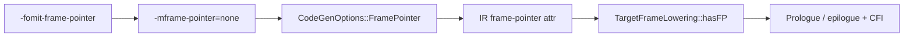

import Head from '@docusaurus/Head';
import FlagArticleShell from '@site/src/components/clang-flags/FlagArticleShell';
import PerfReport from '@site/src/components/clang-flags/PerfReport';
import AsmDiff from '@site/src/components/clang-flags/AsmDiff';
import SourceCode from '@site/src/components/clang-flags/SourceCode';
import KeyFacts from '@site/src/components/clang-flags/KeyFacts';
import Tabs from '@theme/Tabs';
import TabItem from '@theme/TabItem';

<Head>
  <title>-fomit-frame-pointer | Clang Flags Explorer</title>
  <meta name="description" content="Clang -fomit-frame-pointer sets backend frame-pointer policy via -mframe-pointer=; it is code generation / TargetFrameLowering, not an LLVM IR optimization pass." />
  <meta name="keywords" content="-fomit-frame-pointer, -fno-omit-frame-pointer, -mframe-pointer=, TargetFrameLowering, hasFP, frame pointer, Clang, LLVM" />
  <meta property="og:title" content="-fomit-frame-pointer | Clang Flags Explorer" />
  <meta property="og:description" content="Backend frame-pointer policy: driver -mframe-pointer=, IR attributes, and TargetFrameLowering::hasFP — not an IR optimization pass." />
  <meta property="og:type" content="article" />
  <meta name="twitter:title" content="-fomit-frame-pointer | Clang Flags Explorer" />
  <meta name="twitter:description" content="Backend frame-pointer policy: driver -mframe-pointer=, IR attributes, and TargetFrameLowering::hasFP — not an IR optimization pass." />
</Head>

{/* HAND_AUTHORED */}
<FlagArticleShell flagPath="-fomit-frame-pointer" summary="Backend frame-pointer policy forwarded as -mframe-pointer=none; TargetFrameLowering::hasFP may still force an FP for VLAs and other constraints.">

<div className="text--center margin-bottom--md"><a className="button button--primary button--lg" href="https://docs.google.com/forms/d/e/1FAIpQLSebP1JfLFDp0ckTxOhODKPNVeI1e21rUqMJ0fbBwJoaa-i4Yw/viewform" target="_blank" rel="noopener noreferrer" aria-label="Subscribe to CompilerSutra Weekly Compiler Notes">✉ Subscribe to Weekly Compiler Notes</a><p className="margin-top--sm">Practical LLVM, Clang, and compiler-engineering notes delivered weekly.</p></div>

## At a glance

| Attribute | Details |
| :--- | :--- |
| **Architecture** | Target-dependent defaults and FP register (`rbp` / `x29` / …) |
| **Category** | Backend / code generation (frame lowering) |
| **Compiler** | Clang, GCC (related); Clang driver maps to `-mframe-pointer=` |
| **Optimization Level** | On many Linux/ELF targets, `-O1` and higher omit by default; `-O0` keeps |
| **Risk Level** | Low for correctness; high for FP-based profilers / some sanitizer workflows |

**Summary**: `-fomit-frame-pointer` asks Clang not to keep a dedicated frame-pointer register when the target’s `hasFP()` logic allows. It is **not** an LLVM IR optimization pass, and it does **not** mean “no stack frame”.

---

## What this flag actually does

1. **Driver policy**: Clang translates the flag into the cc1 option `-mframe-pointer=` (`none` when omitting, `all` when forcing keep with `-fno-omit-frame-pointer` on Ubuntu clang 18.1.3).
2. **CodeGen / IR**: Keep policies commonly appear as a function attribute `"frame-pointer"="all"` (and module metadata). Omit often means that keep attribute is absent rather than always printing `"frame-pointer"="none"` — inspect IR for your Clang version.
3. **Backend decision**: `TargetFrameLowering::hasFP()` (target override, e.g. `X86FrameLowering::hasFP`) decides whether a dedicated FP is required. Variable-sized objects, realignment, EH, and other conditions can force an FP **even when** omit is requested.
4. **Unwind / CFI**: `.cfi_*` / `.eh_frame` can still describe CFA in terms of `rsp` (or another register). Omitting the FP register ≠ omitting unwind metadata.

:::caution
Do not call `-fomit-frame-pointer` an LLVM optimization pass. Do not claim it always frees a general-purpose register, and do not equate it with stack-frame elimination.
:::

### Defaults and precedence — which `-O` enables omit?

**No LLVM IR optimization pass enables this flag.** On Linux `x86_64` (this host), the Clang **driver** decides the default from the last `-O` group argument via `areOptimizationsEnabled()` → `useFramePointerForTargetByDefault()` → `getFramePointerKind()`.

`areOptimizationsEnabled` (llvmorg-18.1.3 `CommonArgs.cpp`) is:

- `false` when there is no `-O*` or the last one is `-O0` → **keep** FP (`-mframe-pointer=all`)
- `true` when the last `-O*` is **anything other than `-O0`** → **omit** FP (`-mframe-pointer=none`)

Verified with Ubuntu clang 18.1.3, `clang -### -c t.c`:

| Last `-O` | Default `-mframe-pointer=` | Effect |
| :--- | :--- | :--- |
| (none) / `-O0` | `all` | Keep dedicated FP |
| `-O1` | `none` | Omit (default enable of omit policy) |
| `-O2` | `none` | Omit |
| `-O3` | `none` | Omit |
| `-Os` | `none` | Omit |
| `-Oz` | `none` | Omit |
| `-Ofast` | `none` | Omit |

So **every non-`-O0` optimization level** turns on the omit-frame-pointer **policy by default** on this Linux x86/x86_64 target — not InstCombine, not a vectorizer, not a named PassBuilder pass.

Still subject to:

- Explicit `-fomit-frame-pointer` / `-fno-omit-frame-pointer` (last wins among that pair)
- Leaf overrides `-m[no-]omit-leaf-frame-pointer` (can yield `non-leaf` instead of `all`)
- Target exceptions in `useFramePointerForTargetByDefault` (Darwin often keeps; Android AArch64/ARM keeps; wasm/xcore never want FP; …)
- Backend `hasFP()` still forcing an FP for VLAs / realign / EH even when policy is `none`

---

## Minimal realistic example

<SourceCode
  file="leaf.c"
  flag="-fomit-frame-pointer"
  language="c"
  code={`int compute_sum(int a, int b, int c, int d) {
  int temp = a + b;
  return temp * (c - d);
}`}
/>

```bash
clang -O1 -fno-omit-frame-pointer -S leaf.c -o keep.s
clang -O1 -fomit-frame-pointer     -S leaf.c -o omit.s
clang -### -O1 -fomit-frame-pointer -c leaf.c 2>&1 | tr ' ' '\n' | rg mframe-pointer
# → -mframe-pointer=none
```

Counter-example (stack without a dedicated FP at `-O0`):

```bash
clang -O0 -fomit-frame-pointer -S leaf.c -o omit-O0.s
# Locals are still spilled relative to %rsp; only the rbp chain is gone.
```

Forced FP despite omit (volatile VLA → `hasVarSizedObjects`):

<SourceCode
  file="vla.c"
  flag="-fomit-frame-pointer"
  language="c"
  code={`int sum_vla(int n, int *base) {
  volatile int tmp[n];
  int s = 0;
  for (int i = 0; i < n; ++i) {
    tmp[i] = base[i];
    s += tmp[i];
  }
  return s;
}`}
/>

```bash
clang -O1 -fomit-frame-pointer -S vla.c -o vla-omit.s
# Still emits pushq %rbp / movq %rsp, %rbp on x86_64 (clang 18.1.3).
```

---

## Before vs. after assembly

Evidence: Ubuntu clang 18.1.3, `x86_64-pc-linux-gnu`, `-O1`.

<Tabs>
  <TabItem value="x86_64" label="x86_64 leaf (-O1)">
    <AsmDiff
      before={`compute_sum:
	.cfi_startproc
	pushq	%rbp
	.cfi_def_cfa_offset 16
	.cfi_offset %rbp, -16
	movq	%rsp, %rbp
	.cfi_def_cfa_register %rbp
	leal	(%rdi,%rsi), %eax
	subl	%ecx, %edx
	imull	%edx, %eax
	popq	%rbp
	.cfi_def_cfa %rsp, 8
	retq`}
      after={`compute_sum:
	.cfi_startproc
	leal	(%rdi,%rsi), %eax
	subl	%ecx, %edx
	imull	%edx, %eax
	retq`}
    />
  </TabItem>
  <TabItem value="x86_O0" label="x86_64 leaf (-O0 omit still has stack)">
    <AsmDiff
      before={`# -O0 -fno-omit-frame-pointer
compute_sum:
	pushq	%rbp
	movq	%rsp, %rbp
	movl	%edi, -4(%rbp)
	movl	%esi, -8(%rbp)
	# ... arithmetic via -N(%rbp) ...
	popq	%rbp
	retq`}
      after={`# -O0 -fomit-frame-pointer
compute_sum:
	movl	%edi, -4(%rsp)
	movl	%esi, -8(%rsp)
	# ... arithmetic via -N(%rsp) ...
	retq`}
    />
  </TabItem>
</Tabs>

:::note
On this leaf at `-O1`, AArch64 (`--target=aarch64-linux-gnu`) produced identical asm for keep and omit (no `x29` setup). Do not assume every target emits an FP prologue whenever `-fno-omit-frame-pointer` is set — confirm with `-S` on your triple.
:::

IR attributes for the same leaf (`-O1`): keep has `"frame-pointer"="all"`; omit drops that attribute. Module metadata `!"frame-pointer"` appeared on the keep build.

---

## Why use it / when not to use it

### When to use

- Production Linux/ELF builds where DWARF/`eh_frame` unwinding is acceptable and you want smaller prologues.
- Workloads that are register-pressure sensitive **after you measure** (especially denser 32-bit ABIs historically).

### When NOT to use

- FP-based sampling (`perf record -g --call-graph fp`, many eBPF stack walkers).
- Sanitizer / crash-reporting workflows that prefer fast FP stacks (`-fno-omit-frame-pointer`).
- Darwin defaults / platform profilers that expect retained frame pointers.

---

## Performance impact

Qualitative: omit can shrink prologues and may free a register for allocation when `hasFP()` is false. Runtime deltas are often noise on modern x86_64; measure.

The following measurements were produced with [CompilerSutraPerf](/docs/project/compilersutra-perf/) ([PyPI](https://pypi.org/project/compilersutra-perf/)) using `csperf` 0.3.0, Ubuntu clang 18.1.3, x86_64-pc-linux-gnu, CPU affinity 0, one warmup, five trials, profiling disabled:

<PerfReport
  beforeTitle="Clang -O2 -fno-omit-frame-pointer"
  afterTitle="Clang -O2 -fomit-frame-pointer"
  without={[40.521, 41.508, 41.473, 41.428, 40.506]}
  with={[40.534, 41.628, 40.625, 41.286, 41.073]}
  note="Mean wall time: 41.087 ms with frame pointers kept versus 41.029 ms with -fomit-frame-pointer on pic_bench.c. Difference within noise on this run — set FP policy from your profiled workload."
/>

---

## Compatibility table

| Target / Architecture | Default at `-O0` | Default at `-O2` | Notes |
| :--- | :--- | :--- | :--- |
| **x86_64-linux-gnu** | Keep | Omit | Verified with clang 18.1.3 |
| **aarch64-linux-gnu** | Keep policy at `-O0` | Often omit | Simple leaves may show no FP even when keep is requested at `-O1` |
| **x86_64-apple-darwin** | Keep | Often keep | Platform profiler expectations |
| **Windows / SEH** | SEH rules apply | SEH-aware | `hasFP` includes Win64 prologue constraints |

---

## Usage example

```bash
clang++ -O2 -fomit-frame-pointer -c engine.cpp -o engine.o
clang++ -O3 -fno-omit-frame-pointer -g bench.cpp -o bench

# Inspect driver → cc1 policy
clang -### -O2 -fomit-frame-pointer -c engine.cpp 2>&1 | tr ' ' '\n' | rg mframe-pointer
```

---

## Adjacent options

- `-fno-omit-frame-pointer` → typically `-mframe-pointer=all`
- `-mframe-pointer={all,non-leaf,reserved,none}` — explicit cc1/enum form (`CodeGenOptions::FramePointerKind`)
- `-momit-leaf-frame-pointer` / `-mno-omit-leaf-frame-pointer` — leaf-specific overrides

---

## How it works inside Clang

| Pipeline Stage | Implementation Detail |
| :--- | :--- |
| **Options.td** | [`fomit_frame_pointer`](https://github.com/llvm/llvm-project/blob/59e601a3d5e7669fdf809b9c6494e6f877ea5cd8/clang/include/clang/Driver/Options.td#L3719); cc1 [`mframe_pointer_EQ`](https://github.com/llvm/llvm-project/blob/59e601a3d5e7669fdf809b9c6494e6f877ea5cd8/clang/include/clang/Driver/Options.td#L8451) marshals `CodeGenOptions::FramePointer` |
| **Driver** | `getFramePointerKind` → `-mframe-pointer=`; default omit when `areOptimizationsEnabled` (any `-O` except `-O0`) on Linux x86_64. Explicit `-fomit-frame-pointer` / `-fno-omit-frame-pointer` override. |
| **LLVM IR** | Keep → `"frame-pointer"="all"` (typical); omit → attribute often absent on 18.1.3 |
| **Target frame lowering** | `X86FrameLowering::hasFP` returns true if frame-pointer elimination is disabled **or** var-sized objects / realignment / EH / … ([llvmorg-18.1.3](https://github.com/llvm/llvm-project/blob/llvmorg-18.1.3/llvm/lib/Target/X86/X86FrameLowering.cpp#L96)) |
| **Object emission** | CFI emitted regardless; CFA may use `rsp` when no dedicated FP |



---

## Related LLVM Optimizations & Backend Mechanisms

**Flag category:** Backend / code generation. **No direct LLVM IR optimization pass** (`NO_DIRECT_IR_OPTIMIZATION_PASS`).

| Mechanism | Stage | Relationship | Effect |
| :--- | :--- | :--- | :--- |
| `areOptimizationsEnabled` / `useFramePointerForTargetByDefault` | Clang Driver | Directly controlled (default) | Any non-`-O0` opt level → default omit on Linux x86_64; `-O0`/no `-O` → keep |
| Frame-pointer driver flags | Clang Driver | Directly controlled | `-fomit-frame-pointer` / `-fno-omit-frame-pointer` select `-mframe-pointer=` |
| `CodeGenOptions::FramePointer` / `-mframe-pointer=` | cc1 / CodeGen | Directly controlled | Enum: `All`, `NonLeaf`, `Reserved`, `None` |
| `"frame-pointer"` function attribute | LLVM IR | Directly controlled / configured | Communicates keep policy to the backend |
| `TargetFrameLowering::hasFP()` / `X86FrameLowering::hasFP` | Machine backend | Backend mechanism | Final FP requirement (VLA, realign, EH, …) |
| Register allocation | Machine backend | Indirectly affected | FP register not reserved as FP when `hasFP()` is false — not a universal extra GPR |
| Prologue / epilogue emission | Machine backend | Indirectly affected | May omit `push %rbp` / `mov %rsp,%rbp` / `pop %rbp` |
| Unwind / CFI | Object emission | Related mechanism | Still required by ABI; independent of dedicated FP |

### How to verify

```bash
clang --version   # Ubuntu clang 18.1.3 used for this article

# Which -O enables omit by default? (Linux x86_64)
for O in '' -O0 -O1 -O2 -O3 -Os -Oz -Ofast; do
  clang -### $O -c leaf.c 2>&1 | tr '"' '\n' | rg 'mframe-pointer='
done
# Explicit overrides
clang -### -O2 -fomit-frame-pointer -c leaf.c 2>&1 | tr '"' '\n' | rg 'mframe-pointer='
clang -### -O2 -fno-omit-frame-pointer -c leaf.c 2>&1 | tr '"' '\n' | rg 'mframe-pointer='

# IR
clang -O1 -fno-omit-frame-pointer -S -emit-llvm leaf.c -o keep.ll
clang -O1 -fomit-frame-pointer     -S -emit-llvm leaf.c -o omit.ll
rg 'frame-pointer' keep.ll omit.ll

# Asm
clang -O1 -fno-omit-frame-pointer -S leaf.c -o keep.s
clang -O1 -fomit-frame-pointer     -S leaf.c -o omit.s
clang -O0 -fomit-frame-pointer     -S leaf.c -o omit-O0.s   # stack via %rsp
clang -O1 -fomit-frame-pointer     -S vla.c  -o vla-omit.s  # FP forced

# Do NOT use: opt -passes=...  — this flag is not an IR opt-pipeline control.
```

### Source investigation

- [Options.td `fomit_frame_pointer`](https://github.com/llvm/llvm-project/blob/59e601a3d5e7669fdf809b9c6494e6f877ea5cd8/clang/include/clang/Driver/Options.td#L3719) (explorer inventory commit `59e601a3…`)
- [Options.td `mframe_pointer_EQ`](https://github.com/llvm/llvm-project/blob/59e601a3d5e7669fdf809b9c6494e6f877ea5cd8/clang/include/clang/Driver/Options.td#L8451)
- Opt-level default: [`areOptimizationsEnabled`](https://github.com/llvm/llvm-project/blob/llvmorg-18.1.3/clang/lib/Driver/ToolChains/CommonArgs.cpp#L1630) (true iff last `-O*` is not `-O0`) and [`useFramePointerForTargetByDefault`](https://github.com/llvm/llvm-project/blob/llvmorg-18.1.3/clang/lib/Driver/ToolChains/CommonArgs.cpp#L75) / [`getFramePointerKind`](https://github.com/llvm/llvm-project/blob/llvmorg-18.1.3/clang/lib/Driver/ToolChains/CommonArgs.cpp#L178)
- Base API: [`TargetFrameLowering::hasFP`](https://github.com/llvm/llvm-project/blob/llvmorg-18.1.3/llvm/include/llvm/CodeGen/TargetFrameLowering.h) (pure virtual; comment: var-sized allocas or FP elimination disabled)
- x86 override: [`X86FrameLowering::hasFP`](https://github.com/llvm/llvm-project/blob/llvmorg-18.1.3/llvm/lib/Target/X86/X86FrameLowering.cpp#L96) — checks `DisableFramePointerElim`, stack realignment, `hasVarSizedObjects()`, frame-address taken, EH helpers, Win64 constraints, …

Still incomplete without matching Darwin SDK experiments and full AArch64 `hasFP` walkthrough for non-leaf functions — re-verify those before publishing target-universal claims.

---

## Key facts

<KeyFacts
  items={[
    { label: 'Argument form', value: 'Flag (no argument)', icon: 'check' },
    { label: 'Accepted by', value: 'Clang driver → cc1 -mframe-pointer=', icon: 'check' },
    { label: 'Stage', value: 'Driver / CodeGen / TargetFrameLowering', icon: 'check' },
    { label: 'Negated by', value: '-fno-omit-frame-pointer', icon: 'check' },
    { label: 'Defined in', value: 'clang/include/clang/Driver/Options.td (fomit_frame_pointer, mframe_pointer_EQ)', icon: 'info' },
    { label: 'IR opt pass?', value: 'No — backend frame policy only', icon: 'info' },
  ]}
/>

</FlagArticleShell>
